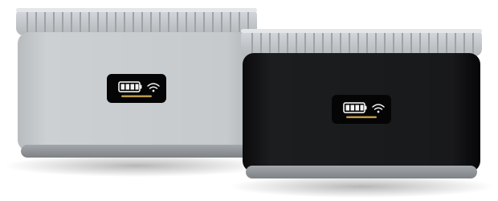

<h1 align="center">Powerness M01 · EPP BES – Home Assistant</h1>

<p align="center"><b>English</b> · <a href="README.de.md">Deutsch</a></p>

<p align="center">
  
</p>

<p align="center">
  Local integration for the <b>Powerness M01</b> / <b>EPP BES 1.5 kWh</b> balcony solar battery (made by DMEGC).<br>
  Set up with a QR code, then everything runs locally over Wi-Fi – no extra integrations, helpers or automations.
</p>

<p align="center">
  <a href="https://hacs.xyz"></a>
  <a href="https://github.com/kuuuraaa/ha-powerness-m01/releases"></a>
  
  
  <a href="LICENSE"></a>
</p>

---

## Why this integration?

The M01 (and the identical EPP BES) is a Tuya device, but it reports almost every value as an
**encoded binary blob**. The official Tuya integration therefore shows nothing at all.
Until now you needed a bundle of *Xtend Tuya*, *LocalTuya*, half a dozen template sensors,
integral helpers and an automation that "wakes up" the battery every minute – because it only
streams live data while the app is open.

This integration replaces all of that:

- 🔌 **Set up in two minutes** – enter the user code from the Smart Life app, scan a QR code,
  done. No Tuya developer account, no copying local keys.
- 🏠 **Fully local** – the cloud is used only once to fetch the local key. After that Home
  Assistant talks to the battery directly and encrypted (Tuya protocol 3.4).
- ⚡ **Live data via push** – about every 5 seconds, no polling. The integration keeps the
  battery awake itself, the old wake-up automation is no longer needed.
- 📊 **Ready for the energy dashboard** – energy counters for charging, discharging and PV are built in.
- 🗓️ **Control the schedule** – up to four charge/discharge periods like in the app, directly
  from Home Assistant or via automations.
- 🔁 **Robust** – finds the battery again after an IP change and remembers the schedule across restarts.

## How it works

1. **Setup:** Using the same QR login as the official Tuya integration, the integration fetches
   the device ID and local key from your Smart Life account.
2. **Connection:** The battery is found on your network through its UDP broadcasts. Home Assistant
   keeps a permanent, encrypted connection open (Tuya 3.4 session key handshake).
3. **Data:** The binary values are decoded inside the integration and exposed as regular sensors.
   When the live data is older than 30 seconds, the integration sends the same command the app
   sends when it is opened.

## Supported devices

| Device | Status |
|---|---|
| **Powerness M01** | ✅ tested (firmware 3.0.9, protocol 3.4) |
| **EPP BES 1.5 kWh** | ✅ identical hardware, same Tuya product ID |
| **DMEGC M01** | ✅ original device (serial numbers start with `DCM01`) |
| Other Tuya batteries in category `cnsb` ("Micro Battery") | 🟡 offered during setup, untested |
| Several batteries stacked | 🟡 totals work, per-battery values will follow |

Do you have a different battery or a stack? An [issue](https://github.com/kuuuraaa/ha-powerness-m01/issues)
with the diagnostics download helps a lot (the local key is removed from it automatically).

## Installation

### Via HACS (recommended)

[](https://my.home-assistant.io/redirect/hacs_repository/?owner=kuuuraaa&repository=ha-powerness-m01&category=integration)

Or by hand:

1. **HACS → ⋮ → Custom repositories**
2. Add `https://github.com/kuuuraaa/ha-powerness-m01` with type **Integration**
3. Install **Powerness M01 / EPP BES Battery**
4. **Restart** Home Assistant

### Manual

Copy the folder `custom_components/powerness` from the
[latest release](https://github.com/kuuuraaa/ha-powerness-m01/releases) to
`/config/custom_components/` (e.g. with the *Samba share* or *Studio Code Server* add-on)
and restart Home Assistant.

## Setup

[](https://my.home-assistant.io/redirect/config_flow_start/?domain=powerness)

1. **Settings → Devices & services → Add integration → "Powerness"**
2. Choose **"Log in with the Smart Life / Tuya app"**
3. In the app: **Me → Settings → Account and Security → User Code** – enter that code
4. **Scan the QR code** with the app, confirm the login in the app, then press **Submit**
5. Done – the battery is found on your network and set up

> [!IMPORTANT]
> Tuya devices accept **only one local connection** at a time. If the battery is set up in
> **LocalTuya** or **Tuya Local**, remove or disable it there first.
> The app, Xtend Tuya and the official Tuya integration (all cloud based) do not interfere.

<details>
<summary><b>Manual setup with a local key</b></summary>

If you already have the local key (e.g. from LocalTuya or tinytuya), choose
**"Enter device ID and local key manually"** instead of the QR login. Leave the IP address empty
to search the network automatically. The M01 uses protocol version **3.4**.
</details>

## Entities

### Measurements

| Entity | Unit | Description |
|---|---|---|
| **State of charge** | % | SOC from the live data |
| **Voltage** | V | battery voltage |
| **Current** | A | positive = charging, negative = discharging |
| **Charge power** | W | power into the battery (always ≥ 0) |
| **Discharge power** | W | power out of the battery (always ≥ 0) |
| **PV current** | A | current from the solar panel |
| **PV power** | W | PV current × battery voltage |
| **Temperature** | °C | temperature inside the battery |
| **Battery state** | – | *Charging*, *Discharging* or *Standby* – like in the app |
| **Time schedule** | – | what the schedule says right now: *Charging*, *Discharging*, *Off* or *Permanent (switch)* |

### Energy (for the energy dashboard)

| Entity | Description |
|---|---|
| **Charged energy** | kWh, integrated from the charge power |
| **Discharged energy** | kWh, integrated from the discharge power |
| **PV energy** | kWh, integrated from the PV power |
| **Charged / Discharged energy (device total)** | lifetime counters of the battery (0.1 kWh resolution) |
| **PV energy (device total)** | lifetime PV yield reported by the battery |

In the energy dashboard, add "Charged energy" as *energy going into the battery* and
"Discharged energy" as *energy coming out of the battery* under **Battery storage**, and
"PV energy" under **Solar**. The device totals work as well; they keep counting while Home
Assistant is off, but only have 0.1 kWh resolution.

### Controls

| Entity | Description |
|---|---|
| **Charge permanently** / **Discharge permanently** | the app's "permanent action" |
| **Period 1–4 from / until / mode** | the app's time schedule (*Configuration* on the device page) |
| **Request live data** | wakes the battery up right away (otherwise happens automatically) |

### Diagnostics

| Entity | Description |
|---|---|
| **Alarm** | on as soon as the battery reports an alarm; the codes are in the `active_codes` attribute |
| **Last live data** | time of the last live data message |

## Time schedule

Like the app, the battery has two operating modes:

| Mode | How to activate it |
|---|---|
| **Permanent** | Turn on *Charge permanently* and/or *Discharge permanently*. The schedule is ignored. |
| **Schedule** | Both permanent switches **off**. Then the up to four periods apply. |

Each of the four periods has **from**, **until** and a **mode** (*Off*, *Charge*, *Discharge*).
A period set to *Off* keeps its times but is not sent to the battery – so you can switch periods
on and off quickly without the others moving. When the schedule is changed in the app, Home
Assistant picks it up automatically.

> [!TIP]
> Use `23:59` for "until midnight" – that is what the app does as well.
> At least one period must stay active; use the permanent switches to stop the schedule.

### Action `powerness.set_schedule`

Replaces the whole schedule in one go – ideal for automations:

```yaml
action: powerness.set_schedule
data:
  config_entry_id: <select your battery>
  periods:
    - {start: "10:00", end: "16:00", mode: charge}
    - {start: "18:00", end: "23:59", mode: discharge}
```

## Examples

<details>
<summary><b>Summer half-year: charge during the day, feed in during the evening</b></summary>

```yaml
automation:
  - alias: "Battery: summer schedule"
    triggers:
      - trigger: time
        at: "00:05:00"
    conditions:
      - condition: template
        value_template: "{{ now().month in [4, 5, 6, 7, 8, 9] }}"
    actions:
      - action: switch.turn_off
        target:
          entity_id:
            - switch.balcony_battery_charge_permanently
            - switch.balcony_battery_discharge_permanently
      - action: powerness.set_schedule
        data:
          config_entry_id: YOUR_ENTRY_ID  # just pick the battery in the automation editor
          periods:
            - {start: "08:00", end: "17:00", mode: charge}
            - {start: "17:00", end: "23:59", mode: discharge}
```

Entity IDs depend on your device name – please adjust them.
</details>

<details>
<summary><b>Notification when the battery is full</b></summary>

```yaml
automation:
  - alias: "Battery full"
    triggers:
      - trigger: numeric_state
        entity_id: sensor.balcony_battery_state_of_charge
        above: 99
    actions:
      - action: notify.notify
        data:
          message: "The balcony battery is full ☀️🔋"
```
</details>

## Options

Under **Settings → Devices & services → Powerness → Configure**:

- **Request live data automatically** (default: on) – keeps the battery awake so the values
  update continuously. Turn it off if only the app should trigger live data.

## Migrating from the DIY setup

If you used Xtend Tuya + LocalTuya + template helpers so far:

1. Remove the battery from **LocalTuya** (otherwise it blocks the local connection).
2. Set up this integration.
3. Add the new energy sensors to the **energy dashboard**.
4. Afterwards you can delete the wake-up automation (`localtuya.set_dp` with `AQEBAQE=`),
   the template sensors for power/voltage/current/SOC and the integral helpers.
   Xtend Tuya and LocalTuya are no longer needed for the battery.

## Troubleshooting

<details>
<summary><b>"Cannot connect to the battery" during setup</b></summary>

- Is the battery still set up in **LocalTuya / Tuya Local**? Remove it there.
- Are Home Assistant and the battery on the **same network**? The automatic search uses UDP
  broadcasts (ports 6666/6667), which do not cross routers or VLANs. Enter the IP address by hand then.
- After a restart the battery sometimes needs a minute until it can be reached locally.
</details>

<details>
<summary><b>"The battery rejected the local key"</b></summary>

The local key changes when the battery is paired again in the app. The integration then asks
for a new QR login by itself.
</details>

<details>
<summary><b>Values update only rarely</b></summary>

Check that the option **Request live data automatically** is on and look at the **Last live data**
sensor. The **Request live data** button lets you test it right away.
</details>

<details>
<summary><b>Time schedule is empty after a restart</b></summary>

The battery only reports its schedule when it changes. The integration asks for it after
connecting and remembers it – on the very first start it can still be empty until you set a
period or change it in the app.
</details>

<details>
<summary><b>Enable debug logging</b></summary>

Choose **Enable debug logging** on the integration page. Every message from the battery is then
logged with all raw values as hex. For bug reports the **diagnostics download** (device page → ⋮)
is even more useful – the local key is removed from it automatically.
</details>

## Technical details

<details>
<summary><b>Data points and binary formats</b></summary>

For everyone who wants to decode more values. The diagnostics download contains all raw data
points as hex as well.

| DP | Name | Format |
|---|---|---|
| 1 | `get_terminal_data` | wake-up command `AQEBAQE=` (`01 01 01 01 01`) |
| 2 | `stack_info` | `01 01` + TLV: `0x0C` SOC, `0x0E`/`0x0F` energy charged/discharged ×0.1 kWh, `0x12` voltage ×0.1 V, `0x13` current ×0.1 A (signed) |
| 4 | `bms_message` | `01 01` + serial number + TLV: `0x03` SOC, `0x08` voltage, `0x0A` current, `0x23`/`0x24` probably index of the highest/lowest cell, `0x25`/`0x26` energy ×0.1 kWh |
| 8 | `bcu_info_hex` | `01 01` + serial number + TLV: `0x07` battery state (`0` charging, `1` discharging, `2` standby) |
| 9 | `alarm_message` | `01 01` + serial number + TLV, one byte per alarm |
| 10 | `battery_dc_data` | `01` + 29 byte blocks: serial number (22) · SOC (1) · voltage ×0.1 V (2) · current ×0.1 A signed (2) · ? signed (2). Block 1 = whole system, then one block per battery |
| 101 / 102 | `charger_switch` / `discharge_switch` | charge / discharge permanently |
| 103 | `time_schedule` | up to 4 × 6 bytes: start h, start min, end h, end min, charge, discharge |
| 104 | `temperature` | °C (integer) |
| 105 | `firmware` | text |
| 107 | `pv_total` | lifetime PV yield ×0.1 kWh |
| 108 | `pv_curr` | PV current ×0.1 A |

TLV = tag (1 byte), length (1 byte), value (big-endian). The scaling of the energy counters is
confirmed by two snapshots a few weeks apart (PV +30.4 kWh, charged +31.3 kWh, discharged +28.7 kWh).

**Still open:** BMS tag `0x1C`, the meaning of the alarm codes, the last 2 bytes of the live data
blocks (`0` idle, `+3` charging, `−1` discharging) and `status_pv` (DP 106).
The Wi-Fi signal strength shown in the app comes from the Tuya cloud and is not available locally.
</details>

## Development

```bash
pip install pytest-homeassistant-custom-component tuya-device-sharing-sdk
pytest
```

The tests run against a simulated battery (`tests/fake_device.py`) that speaks the device side of
the Tuya 3.4 protocol – including handshake, encryption and push messages. The test data comes
from a real M01 (serial number anonymized).

Contributions are welcome – especially data from other batteries, stacked batteries or active alarms.

## Credits

This integration would not exist without the work of other projects – a big thank you to
everyone behind them!

| Project | What we owe it |
|---|---|
| [Home Assistant – Tuya integration](https://github.com/home-assistant/core/tree/dev/homeassistant/components/tuya) | The Smart Life QR login is adapted from its config flow and uses the same public client. |
| [tuya-device-sharing-sdk](https://github.com/tuya/tuya-device-sharing-sdk) by Tuya | Library for the login and for fetching device ID and local key. |
| [tinytuya](https://github.com/jasonacox/tinytuya) by Jason Cox | The most thorough documentation of the local Tuya protocol (frames, 3.4 session key handshake, UDP discovery) – the basis for our own async protocol client. |
| [LocalTuya](https://github.com/rospogrigio/localtuya) by rospogrigio and contributors | Showed how to run Tuya devices locally in Home Assistant; the wake-up command for the live data was found and tested with it. |
| [Xtend Tuya](https://github.com/azerty9971/xtend_tuya) by azerty9971 | Made the battery's data points visible in the first place – its diagnostics were the starting point for decoding them. |
| [pytest-homeassistant-custom-component](https://github.com/MatthewFlamm/pytest-homeassistant-custom-component) by Matthew Flamm | Test environment for custom integrations. |
| [HACS](https://hacs.xyz) | Distribution and updates. |

No code from LocalTuya, Xtend Tuya or tinytuya was copied; the protocol client is an own
implementation based on the protocol details documented there.

## Disclaimer

This is a private community project and is not affiliated with Powerness, EPP, DMEGC, Tuya or
Home Assistant. All trademarks belong to their respective owners. Use at your own risk.

## License

[MIT](LICENSE)
